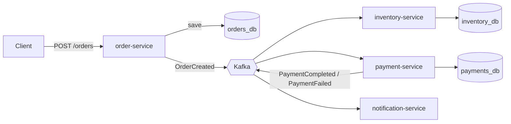

# Order Platform

A small event-driven backend I'm building to learn how microservices talk to each other through Kafka. You place an order through a REST API, and that order becomes an event that other services react to on their own.

I built this because Kafka, Spring Boot, Docker, and Postgres kept showing up in internship postings, and I wanted to use them together instead of just reading about them.

## Status

This is a work in progress, and I'm building it one service at a time.

| Service | What it does | Status |
|---|---|---|
| `order-service` | `POST /orders`: saves the order to Postgres, then publishes an `OrderCreated` event to Kafka | Done |
| `inventory-service` | Consumes `OrderCreated`, updates stock | Planned |
| `payment-service` | Consumes `OrderCreated`, simulates a payment, publishes `PaymentCompleted` or `PaymentFailed` | Planned |
| `notification-service` | Consumes payment results and logs a notification | Planned |

After the core flow works, I want to add retries with a dead-letter topic, integration tests with Testcontainers, and a short demo video.

## How it works



The services never call each other directly. They only communicate through Kafka events, and each service owns its own database. That means one service can go down without taking the others with it, though the trade-off is that you have to think carefully about what happens when things fail halfway.

## Tech stack

- Java 21 and Spring Boot 4.1.1 (Maven)
- Apache Kafka
- PostgreSQL 16
- Docker Compose for local infrastructure
- JUnit for tests

## Running it locally

You'll need Java 21 and Docker Desktop.

**1. Start Kafka and Postgres**

```bash
docker compose up -d
```

This also creates three separate databases (`orders_db`, `inventory_db`, `payments_db`) using `init-db.sql`.

**2. Start the order service**

```bash
cd order-service
./mvnw spring-boot:run
```

**3. Place an order**

```bash
curl -i -X POST http://localhost:8080/orders \
  -H "Content-Type: application/json" \
  -d '{"customerId": 1, "productId": 101, "quantity": 2}'
```

You should get back a `201 Created`. To see the event that was published:

```bash
docker exec -it kafka /opt/kafka/bin/kafka-console-consumer.sh \
  --bootstrap-server localhost:9092 \
  --topic order-created \
  --from-beginning --timeout-ms 5000
```

**Running the tests**

```bash
cd order-service
./mvnw clean verify
```

## Design decisions and trade-offs

A few choices I made, and why:

- **Plain JSON events, no Java class headers.** Spring's Kafka serializer normally stamps the Java class name into each message, which would break consumers in other services that define their own event classes. I turned that off so any service can read the message without sharing code.
- **Database per service.** Each service has its own database, so they stay independent. The cost is that there are no cross-service joins or transactions.
- **Save first, then publish.** `order-service` saves the order, then publishes the event and waits for Kafka to acknowledge it before returning `201`. The catch is that if Kafka fails after the database commit, there's a saved order with no event. The usual fix is the transactional outbox pattern, which I'd like to add later.

## Repo layout

```
order-platform/
├── order-service/
├── inventory-service/
├── payment-service/
├── notification-service/
├── docker-compose.yml
└── init-db.sql
```

## What I'm learning from this

Event-driven design, how consumers and topics work in Kafka, why services need their own data, and how much of the work is thinking about failure cases rather than the happy path.