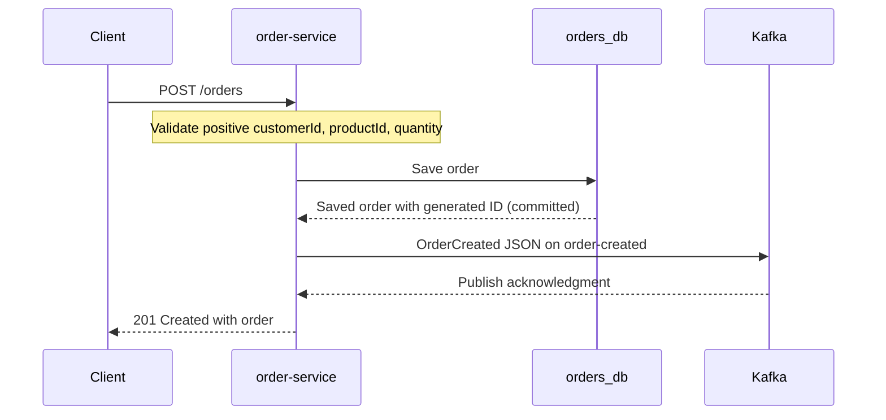

# Current implemented order flow

Only the order service currently has business logic. Inventory, payment, and
notification are application skeletons; the README's full architecture diagram
shows the intended system rather than the implemented flow.

If saving fails, no event is published. If publishing fails after saving, the
request fails but the saved order remains. Saving and publishing are not atomic.
No application consumer currently processes the event.
